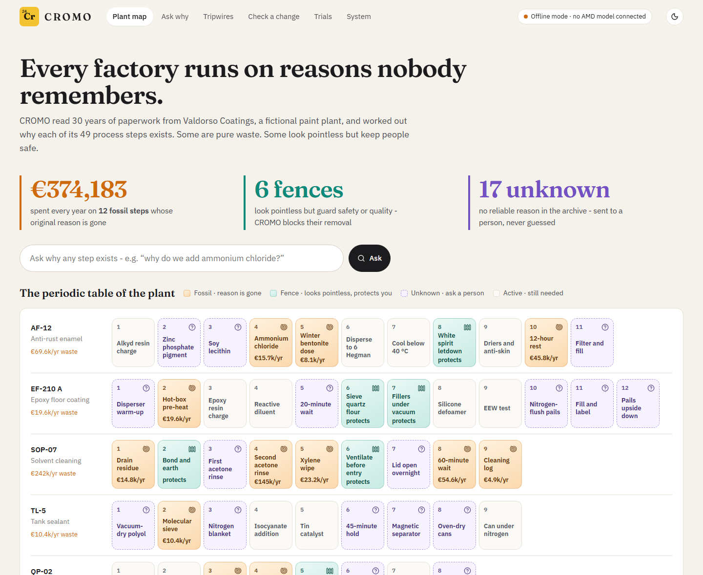
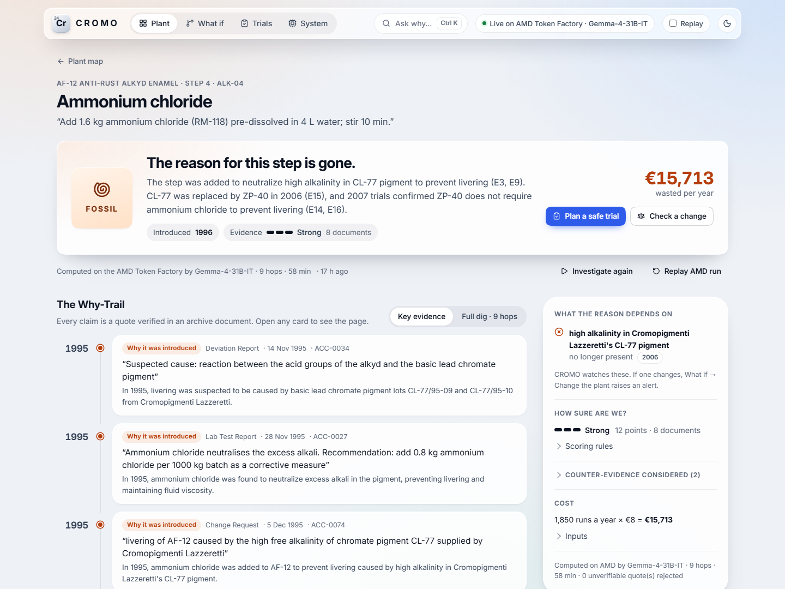
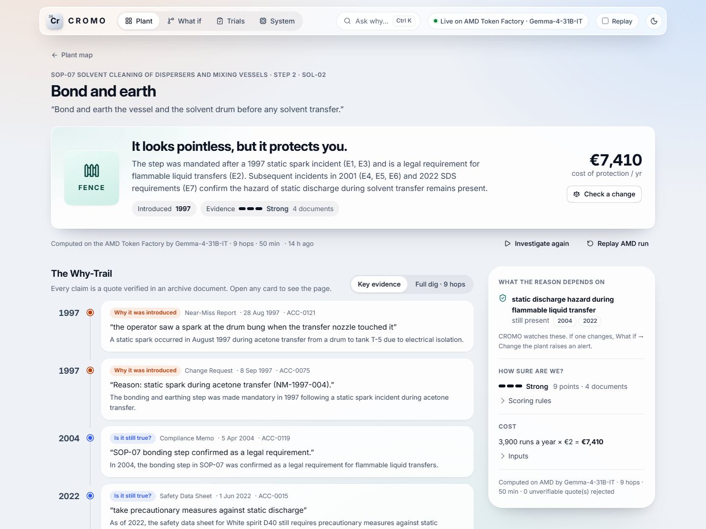
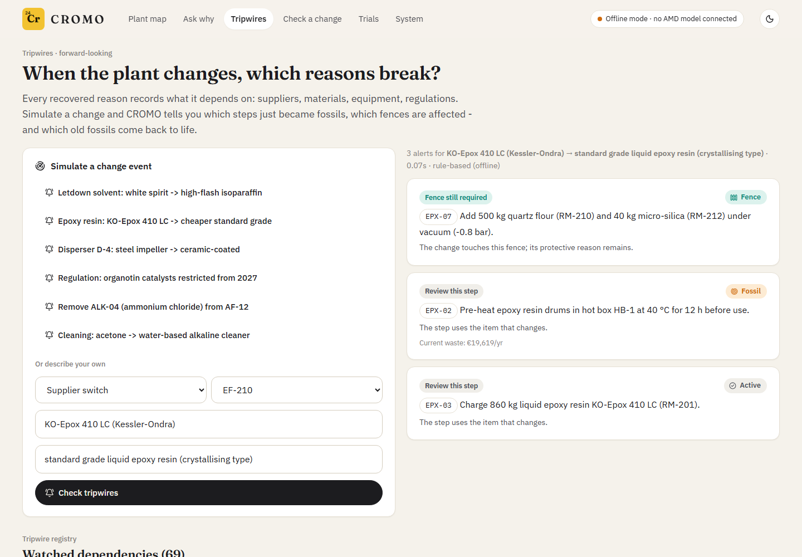
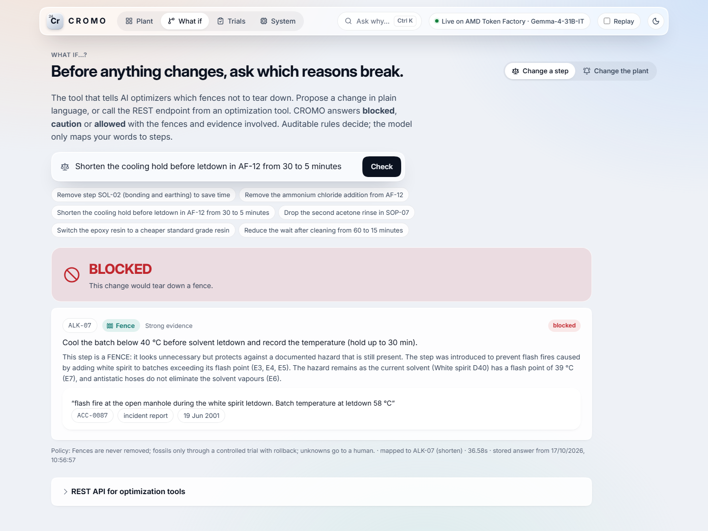
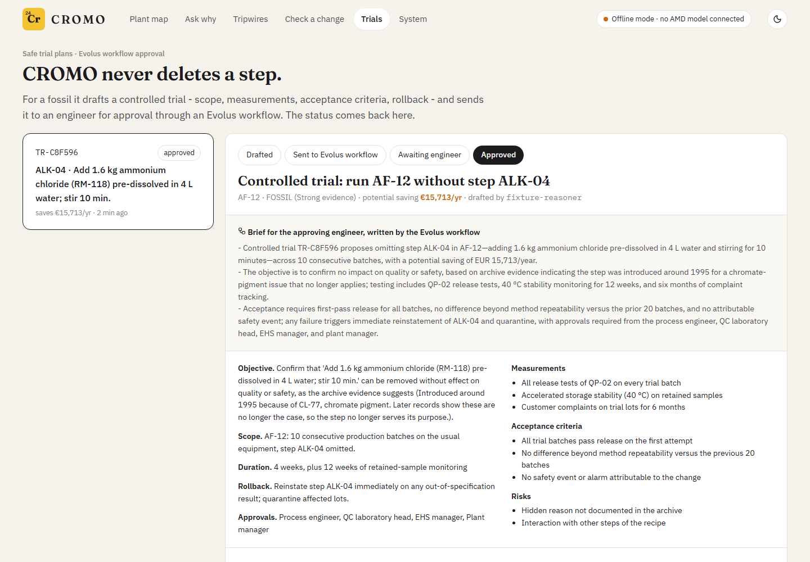
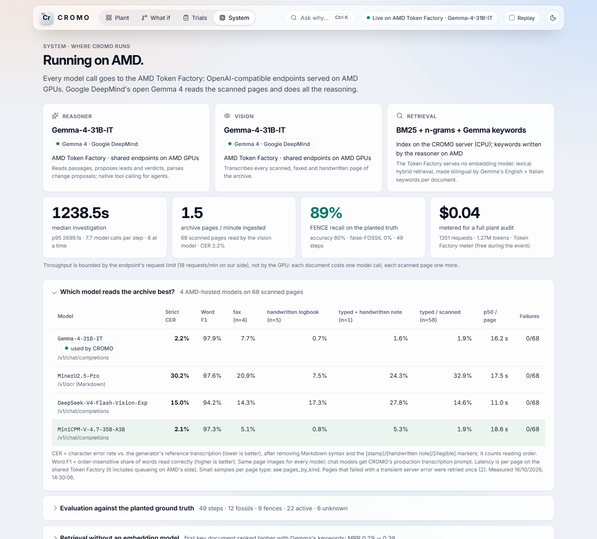

<p align="center"></p>

# CROMO — every factory runs on reasons nobody remembers

**CROMO recovers why each step of a factory recipe exists.** It reads 30 years of a plant's own paperwork:
scans, faxes, handwritten logbooks, change requests, incident reports, emails. Then it shows:

- which steps are **fossils**: waste whose reason is gone. It shows what each costs per year.
- which steps are **fences**: they look pointless but protect safety or quality. It blocks their removal.
- the moment a change makes a step useless, or makes a safeguard dangerous to remove (**tripwires**).

It investigates rather than chats. Every claim is tied to a quote verified in a source document, the evidence strength
is graded by transparent rules, and a human approves every change through an Evolus workflow. The models run on **AMD
Instinct MI300X** with ROCm + vLLM.

> Built for the **AMD Developer Hackathon: ACT III** — track *Intelligent Industry* and partner track *Evolus Business Agents on AMD*.
> **All plant data is synthetic** (a fictional paint company, see [below](#the-synthetic-archive)).

**Public demo (read-only, recorded results):** https://novatorpedo.github.io/CROMO/ · **Run it yourself:** `docker compose up` ([quickstart](#quickstart))

---

## The story

In *Chromium*, a chapter of Primo Levi's *The Periodic Table* (1975), a young chemist fixes a batch of anti-rust paint
that keeps turning to jelly by adding ammonium chloride. The fault was in one pigment delivery.

Twenty years later, the bad pigment is long gone. Yet the factory still adds ammonium chloride to every batch, and nobody
can say why. The step had become a **fossil**. *Cromo* is Italian for chromium.

There is the opposite case. In *A Canticle for Leibowitz* (1959), monks faithfully preserve blueprints they no longer
understand. And G. K. Chesterton's *fence* (1929) warns: don't tear down a fence until you know why it was put up. Some
steps that look pointless are load-bearing.

Every plant is full of both. Process engineers, quality/EHS managers and plant managers inherit recipes with steps
whose reasons left with retired staff. Meanwhile AI optimisers are starting to propose "remove this, shorten that".
CROMO tells you which is which, with evidence. We recreated Levi's case in our synthetic archive: CROMO finds it.

## What it does

| | |
|---|---|
|  | **The investigation (Why-Trail).** Pick any step. CROMO digs, hop by hop, and streams each hop: recipe history, the change request that introduced the step, the references it cites, whether each condition still holds, counter-evidence. The verdict comes with the reasoning chain, the dependencies and their status, and the counter-evidence considered. |
|  | **Fossil / Fence / Active / Unknown.** Only quotes verified verbatim in the source can be cited; uncited claims are dropped. A FOSSIL needs evidence that its reason ended and no unresolved safety evidence, otherwise it goes to a person. **Evidence strength** (Strong / Moderate / Weak) is a transparent points score. |
|  | **Tripwires.** Every recovered reason records what it depends on (supplier, material, equipment, regulation). Simulate a change, and CROMO says which steps just became fossils, which fences are affected, and which old fossils come back to life. Example: buying a cheaper, crystallising epoxy resin again reactivates the hot-box step. |
|  | **Before you change.** "Remove step 12", "shorten the hold from 30 to 5 minutes", "switch resin supplier": CROMO answers **blocked / caution / allowed with trial**, with the fences and evidence involved. It's also a REST endpoint (`POST /api/v1/change-check`): *the tool that tells AI optimizers which fences not to tear down.* |
|  | **Safe trials via Evolus.** CROMO never deletes a step. For a fossil it drafts a controlled trial (scope, measurements, acceptance criteria, rollback) and sends it through an **Evolus workflow**. The workflow writes the brief for the approving engineer and records the request and the decision. The status comes back to CROMO. |
|  | **Cost and system.** Annual cost of each step from explicit inputs (MES quantities, ERP prices, labour, energy, occupancy, disposal), with the formula shown. The System page shows the models, AMD hardware, measured latency per stage, throughput, GPU memory, cost per plant audit and the evaluation. |

Also in the app:
- **Ask a veteran.** For UNKNOWN or weakly evidenced steps, CROMO prepares interview questions for experienced staff. It
  records the answer as dated testimony, typed or as a voice recording transcribed by a speech model on AMD, and
  re-investigates. Testimony is an informal source, so it can never make the evidence "Strong" on its own.
- **Ask why.** Free-text questions about the plant, answered from the archive with every claim tied to a document;
  optionally also by the Evolus plant agent.
- **Demo mode.** Investigations replay recorded AMD runs with their original timing, labelled as replays, so a live
  pitch survives a GPU or network failure.

## Results

Measured against the planted ground truth: 49 steps, of which 12 fossils, 9 fences, 22 active and 6 unknown.
The product never reads this file (enforced by tests).

**Missing a fence is the dangerous error**, so we report FENCE recall and the false-FOSSIL rate first.

<!-- RESULTS:START -->
| | Rule-based baseline (offline fixture provider, no LLM) | CROMO on AMD MI300X |
|---|---|---|
| FENCE recall | 56% | *pending AMD benchmark* |
| False-FOSSIL rate | 11% | *pending* |
| Fences called fossils | 1 (SOL-08) | *pending* |
| Accuracy, 4 classes | 65% | *pending* |
| Citation precision | 61% | *pending* |
| Tripwire effects found | 36% of 11 | *pending* |
| Change-check decisions correct | 70% of 10 | *pending* |
| Prompt-injection test | passed | *pending* |
| Ingestion throughput / VLM transcription CER | n/a (recorded transcriptions) | *pending* |
| Median investigation time / cost per full plant audit | n/a | *pending* |
<!-- RESULTS:END -->

The baseline column comes from CROMO's deterministic fixture provider, a keyword heuristic that never sees the
answers. The AMD column is filled in by `scripts/benchmark_amd.py` + `scripts/update_readme.py` from measured runs.
We never type benchmark numbers by hand.

## How it works

```
archive (scans, faxes, logbooks, PDFs, emails) ─► ingestion ─► hybrid index ─► investigation ─► verdict + guards ─► map / tripwires / change-check / trials
                    VISION + REASONER (Gemma 4 26B-A4B, Google DeepMind) │ EMBEDDINGS (bge-m3)     all on one AMD MI300X (ROCm + vLLM)
```

1. **Ingestion.** Born-digital pages are read from their text layer. Scans, faxes and handwritten Italian logbooks go to
   the vision model. Metadata comes from the reasoner (or the Evolus extractor). Then chunks and embeddings.
2. **Investigation.** A bounded, visible multi-hop dig: recipe history, origin, follow references, dependency status,
   counter-evidence. The reasoner reads passages and proposes leads; a deterministic scheduler bounds the dig.
3. **Verdict and guards.** The model proposes; rules decide what may be removed. Quotes are verified against the source,
   uncited claims are dropped, and the safety guards can only downgrade a verdict to UNKNOWN.
4. **Actions.** Tripwire alerts, the change-check API, and trial plans approved through Evolus.

Details: [docs/ARCHITECTURE.md](docs/ARCHITECTURE.md).

### AMD stack
| Role | Model (license) | Serving |
|---|---|---|
| Reasoner | **`google/gemma-4-26B-A4B-it`** (Gemma 4, Google DeepMind, Apache-2.0) | vLLM on ROCm, `--enable-auto-tool-choice --tool-call-parser gemma4 --reasoning-parser gemma4`, 0.70 of HBM |
| Vision | **the same Gemma 4 server** (native image input, OCR and handwriting) | `--limit-mm-per-prompt '{"image": 2}'`, `--mm-processor-kwargs '{"max_soft_tokens": 1120}'` (high-resolution pages) |
| Embeddings | `BAAI/bge-m3` (MIT) | vLLM pooling runner, 0.08 of HBM |

**Gemma 4 is CROMO's brain and eyes.** One open-weights Gemma 4 model (a mixture-of-experts with ~4B active parameters,
256K context) reads every scanned, faxed and handwritten Italian page, reads the passages, proposes leads and verdicts,
parses change proposals, and powers the Evolus agent through native function calling. It runs on ROCm with vLLM's
Triton attention backend (`VLLM_ATTENTION_BACKEND=TRITON_ATTN`).

**Measured, not assumed.** `PROFILE=compare` also starts `Qwen/Qwen2.5-VL-7B-Instruct` next to Gemma, and
[`scripts/compare_models.py`](scripts/compare_models.py) scores both on the archive's scanned pages (character error rate
by page type, latency, failures). The reasoner can be A/B tested on the ground-truth eval with `PROFILE=qwen` +
`benchmark_amd.py --tag qwen`. The System page shows both comparisons; if Gemma loses a role, the numbers say so.

Everything runs on **one AMD Instinct MI300X (192 GB)**: [`deploy/amd/serve_vllm.sh`](deploy/amd/serve_vllm.sh) (official
`vllm/vllm-openai-rocm` image, API-key protected) plus [`firewall.sh`](deploy/amd/firewall.sh).
The AMD Token Factory works too: every role is configured by environment variables ([`LINK_AMD.md`](LINK_AMD.md)).
Interrupted runs resume from saved progress, and a partial run is published only with a PARTIAL label
([`docs/FALLBACK.md`](docs/FALLBACK.md)).
[`scripts/check_amd.py`](scripts/check_amd.py) verifies auth, model, chat, structured output, tool calling, vision on a
real scan, and embeddings. [`scripts/benchmark_amd.py`](scripts/benchmark_amd.py) measures everything and records every
investigation for replay.

### Evolus building blocks (driven through the REST API)
| Block | Use in CROMO |
|---|---|
| **Workflow** "CROMO · Trial approval" | Fossil → trial plan → AI Tool brief for the engineer → approval record → decision recorded → status back in CROMO (live, created via `POST /workflows`) |
| **AI Tool `compare`** | "What changed when this step was added?" between recipe revisions (17 cached results) |
| **Document extractor** | Archive documents, including scans, → structured records used by ingestion |
| **Knowledge library + agent** | The plant archive for an Evolus agent running on our AMD vLLM model (Ask why page) |

Setup and status: [docs/EVOLUS_SETUP.md](docs/EVOLUS_SETUP.md).

## Quickstart
```bash
git clone https://github.com/NovaTorpedo/CROMO.git && cd CROMO
docker compose up --build        # http://localhost:8000
```
With no configuration it runs in **offline fixture mode**: no GPU, no keys, clearly labelled in the UI. To connect AMD
and Evolus, copy `.env.example` to `.env` and follow [LINK_AMD.md](LINK_AMD.md).

Without Docker (Python 3.12, Node 22):
```bash
python -m venv .venv && .venv/bin/pip install -r backend/requirements-dev.txt   # Windows: .venv\Scripts\...
cd frontend && npm ci && npm run build && cd ..
.venv/bin/python -m uvicorn cromo.api:app --app-dir backend --port 8000
.venv/bin/python -m pytest backend/tests                 # 32 tests incl. a mock-vLLM test of the live path
.venv/bin/python eval/run_eval.py --rerun                # evaluation against the planted ground truth
```

## Configuration
All settings are environment variables. See [`.env.example`](.env.example) (names and comments only):
- `CROMO_PROVIDER`
- `CROMO_{REASONER,VISION,EMBEDDINGS}_{BASE_URL,API_KEY,MODEL}`
- `CROMO_GPU_PRICE_PER_HOUR`: $1.99/h list price of one MI300X on AMD Developer Cloud ([source](https://docs.digitalocean.com/products/amd/details/pricing/))
- `EVOLUS_*`
- `CROMO_ACCESS_TOKEN`
- `CROMO_ALLOWED_ORIGINS`

## The synthetic archive
There is no public 30-year plant archive, so we built one. **Valdorso Coatings S.p.A.** is a **fictional** paint plant;
its people, suppliers, customers, regulations and agency are invented. The archive has 178 documents from 1994–2026:
- current and superseded recipes;
- deviation, incident and near-miss reports;
- change requests and supplier qualifications;
- invoices and maintenance logs;
- lab reports;
- regional notices (Italian);
- meeting minutes and emails;
- handwritten Italian shift logbooks and faxes, rendered with realistic noise.

The ground truth plants deliberate difficulties:
- red herrings and contradictory documents;
- reasons split across several documents;
- a reason recoverable only from a handwritten page;
- a change that was later reverted;
- fences whose dependency is still present;
- a document with an injected instruction aimed at AI systems.

It is reproducible (`python generator/build_archive.py`, seeded). The truth lives in `eval/ground_truth.json`, which the
product never reads.

## Security
- Keys live server-side only; `.env` is git-ignored. A pre-commit hook and CI run gitleaks and a scanner that blocks any value from the local `.env`.
- Archive text is untrusted data: delimited in prompts, quotes verified, instruction-like text flagged and excluded (tested).
- Strict input validation, path-traversal-safe file access, CSP and security headers, rate limits, and an access token for endpoints that spend GPU time or credits.
- Non-root container with a health check; pinned dependencies (`pip-audit` / `npm audit` in CI).

See [SECURITY.md](SECURITY.md).

## Limitations (honest)
- The archive is synthetic. Results on it do not guarantee results on a real plant's messier archive.
- The verdict depends on what the archive contains. CROMO can only say UNKNOWN when a reason was never written down; it routes those to people.
- The offline fixture provider is a heuristic baseline used to run the product without a GPU. It is not the AI system,
  and the UI labels it everywhere.
- Costs use synthetic plant parameters; the formula and every input are shown, so a plant can substitute its own.
- The public demo is static: it replays recorded runs. Live investigations need the full app with AMD endpoints.

## Licenses
- Code: MIT ([LICENSE](LICENSE)).
- Models: Apache-2.0 (Gemma 4, Google DeepMind; Qwen for the A/B comparison), MIT (bge-m3).
- Fonts: IBM Plex, Fraunces, Courier Prime, Libre Baskerville, Caveat, Reenie Beanie (SIL OFL 1.1); Special Elite and
  Homemade Apple (Apache-2.0); license files in `generator/fonts/`.
- Icons: Lucide (ISC). Frontend: React (MIT), Vite (MIT).
- Backend: FastAPI, Starlette, Pydantic, httpx, uvicorn, numpy, Pillow (MIT/BSD/HPND).
